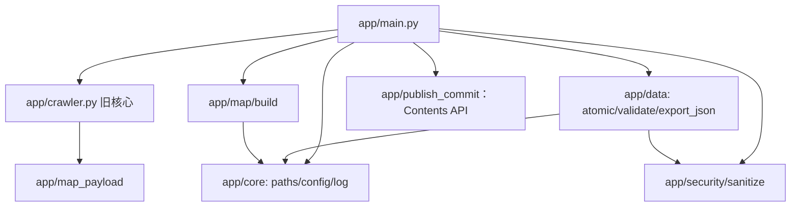

# 架构与设计决策记录

版本：V2.1 　最后更新：2026-11-21

## 分层

依赖方向只允许「上层 → 下层」，`core` 不依赖任何业务模块，`sanitize` 不依赖 `map`，避免循环。

## 决策 1：渐进式重构而不是重写

- 背景：`app/crawler.py` 68KB，承载 158 列映射与青鸾接口细节；`app/map_payload.py` 与它强耦合。
- 决策：新代码放 `app/core`、`app/data`、`app/map`、`app/security`，通过函数调用旧模块，不搬家、不拆解。
- 代价：目录不是「纯教科书结构」；收益：0 回归风险，158 列能力完整保留（已用真实 18 条数据验证）。

## 决策 2：发布链「脱敏 + 自检」一条命令

`python -m app.main publish` 内部顺序固定：load 完整 payload → validate → sanitize → build_map → verify → write dist。任一步抛错即整体失败，不产出半成品。

## 决策 3：提交走 GitHub Contents API

- 事实：本机 `git push` 反复出现 `schannel: server closed abruptly`，而 `api.github.com` 稳定可达。
- 决策：`app/publish_commit.py` 用 API 逐文件提交（`data.json`、`index.html`），`scripts/deploy_github.py` 保留 git 兜底。
- 约束：不使用 `--force`，不重写历史。

## 决策 4：失败不覆盖

`validate` 与 `export_public` 都以「上一版快照」为参照；条数低于阈值（默认 60%）→ BLOCKED，旧数据继续服务。页面加载失败时前端退回内置快照并标注时间，不显示假数据。

## 决策 5：不用数据库

数据量几十到几百条，JSON + 静态页 + GitHub 免费额度足够；引入数据库只会增加运维与成本，违背「全部免费、无需服务器」的约束。

## 待评估

- Cloudflare Access + 受保护数据服务，用于「线上查看完整数据」（当前明确不做，见 `docs/10_安全说明.md`）
- 项目名称可能包含小区/单位名，是否需要更严格掩码（当前保留全名以保证可检索性）
